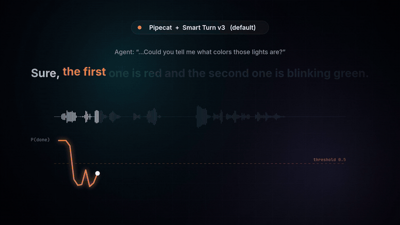

<div align="center">

<a href="https://swagshaw.github.io/voxturn/"></a>

# voxturn

**Knows when you're done talking.** An open turn-taking model for voice agents.

[](https://swagshaw.github.io/voxturn/)
[](https://huggingface.co/AustinXiao/voxturn-v1)
[](https://huggingface.co/AustinXiao/voxturn-v1#use-with-pipecat)
[](https://huggingface.co/AustinXiao/voxturn-v1#use-with-livekit-agents)
[](https://creativecommons.org/licenses/by-nc/4.0/)

**[▶ Try the interactive demo](https://swagshaw.github.io/voxturn/)** · **[Get the model](https://huggingface.co/AustinXiao/voxturn-v1)**

</div>

---

A voice agent has to decide, many times a second, whether a silent user has finished their turn. Reply too early and
it cuts them off; reply too late and the conversation drags. voxturn listens to the last 8 seconds of audio and answers
the questions an agent actually has, **all in one forward pass**:

| Question | Options |
|---|---|
| `eot`: has the user finished their turn? | yes / no |
| `resume`: when will the user go on? | within 0.5 s / later / not this turn |
| `state4`: what kind of utterance was it? | complete / incomplete / backchannel / wait |
| `intent`: while the agent talks, is this an interruption? | interrupt / backchannel |
| `invalid`: is the sound not speech at all? | yes (cough, laughter, noise, music) / no |

<div align="center">

<br><sub>Same framework, same VAD, same user. Left: Pipecat's default Smart Turn v3 interrupts mid-sentence. Right: voxturn waits, then replies 0.32 s after the user finishes.</sub>
</div>

## Highlights

| | |
|---|---|
| 🎯 **Accurate** | 11.5% false cut-offs at a 300 ms latency budget on English [eot-bench](https://huggingface.co/datasets/livekit/eot-bench-data), ahead of the commercial Baton (12.3%) and Deepgram Flux (12.9%) |
| 🌍 **Multilingual** | 19.9% mean over 14 languages, the best among open models (LiveKit v1-mini 28.4%, Smart Turn v3.2 39.7%) |
| ⚡ **Fast** | 8.3 ms per decision on one GPU; 4 questions in one pass take 9.0 ms instead of 33.2 ms |
| 🔌 **Drop-in** | plugins for Pipecat (turns cut off: 45.3% → 16.7%) and LiveKit Agents (18.0% → 9.3%, with lower latency) |
| 🪶 **Small** | one 0.8B model (Qwen3-ASR-0.6B backbone), 1.9 GB of GPU memory; also runs on CPU |

## Quick start

```bash
pip install "transformers>=5.19" peft safetensors huggingface_hub scipy torch
```

```python
import sys
from huggingface_hub import snapshot_download
sys.path.insert(0, snapshot_download("AustinXiao/voxturn-v1"))
from voxturn import VoxTurn

model = VoxTurn.from_pretrained("AustinXiao/voxturn-v1")      # device="cpu" works too
model.predict(audio, sample_rate=16000, questions=["eot", "resume", "invalid"])
# {'eot': {'yes': 0.93, 'no': 0.07}, 'resume': {'soon': 0.04, 'later': 0.05, 'no': 0.91}, 'invalid': {...}}
```

Ask it when your VAD reports a pause, then again every 0.25 s while the silence lasts, and reply once `eot.yes`
reaches your threshold (0.8 by default in the plugins).

<details>
<summary><b>Pipecat</b></summary>

```python
from pipecat_voxturn import VoxTurnAnalyzer          # from the Hugging Face snapshot above
from pipecat.turns.user_stop import TurnAnalyzerUserTurnStopStrategy
from pipecat.turns.user_turn_strategies import UserTurnStrategies

strategies = UserTurnStrategies(stop=[TurnAnalyzerUserTurnStopStrategy(turn_analyzer=VoxTurnAnalyzer())])
```
</details>

<details>
<summary><b>LiveKit Agents</b></summary>

```python
from livekit_voxturn import VoxTurnDetector          # from the Hugging Face snapshot above
from livekit.agents import AgentSession
from livekit.plugins import silero

session = AgentSession(vad=silero.VAD.load(min_silence_duration=0.3),
                       turn_handling={"turn_detection": VoxTurnDetector()})
```
</details>

## Results

**eot-bench, English** (false cut-offs at a mean-latency budget, latency at a cut-off budget; lower is better)

| Model | Open | @ 300 ms | @ 600 ms | Latency @ 5% |
|---|---|---|---|---|
| LiveKit Turn Detector v1 | no | 9.9% | 4.5% | 543 ms |
| p99lab turn-1 (~2.8B) | yes | 10.6% | 4.5% | 553 ms |
| **voxturn v1 (0.8B)** | **yes** | **11.5%** | **6.0%** | **669 ms** |
| JoinIn AI Baton | no | 12.3% | 4.8% | 577 ms |
| Deepgram Flux | no | 12.9% | 9.9% | 1151 ms |
| LiveKit v1-mini | yes | 27.8% | 12.1% | 1070 ms |
| Smart Turn v3.2 | yes | 35.2% | 14.8% | 1051 ms |

**In voice-agent frameworks** (150 English eot-bench turns replayed through each framework's VAD and endpointing; a
turn is cut off if the agent replies in any of its mid-turn pauses)

| Framework | Default turn model | with voxturn |
|---|---|---|
| Pipecat | 45.3% cut off, 1.32 s mean delay | **16.7% cut off, 0.36 s** |
| LiveKit (VAD 0.3 s) | 18.0% cut off, 0.73 s | **9.3% cut off, 0.47 s** |

Per-language results, speed and more details are on the [model card](https://huggingface.co/AustinXiao/voxturn-v1).

## About this repository

This repository hosts the [demo site](https://swagshaw.github.io/voxturn/) (GitHub Pages, plain HTML/CSS/JS, no
build step). Everything on it was computed offline: real eot-bench user turns streamed through Pipecat's Silero VAD,
once with Pipecat's default Smart Turn v3 and once with voxturn, plus both models' P(end of turn) every 100 ms. The
model weights, inference code and plugins live on [Hugging Face](https://huggingface.co/AustinXiao/voxturn-v1).

## License and citation

voxturn weights and code: [CC BY-NC 4.0](https://creativecommons.org/licenses/by-nc/4.0/). Demo audio, word timings and
pause labels: [LiveKit eot-bench](https://huggingface.co/datasets/livekit/eot-bench-data) (CC BY 4.0). Baseline numbers
are the official eot-bench results; turn-1's are from its model card.

```bibtex
@misc{voxturn2026,
  title  = {voxturn v1: an open multilingual turn-taking model answering several questions in one pass},
  author = {Xiao, Yang},
  year   = {2026},
  url    = {https://huggingface.co/AustinXiao/voxturn-v1}
}
```
